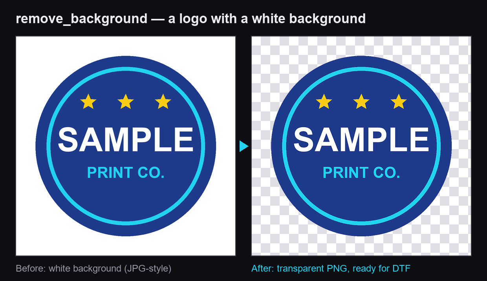
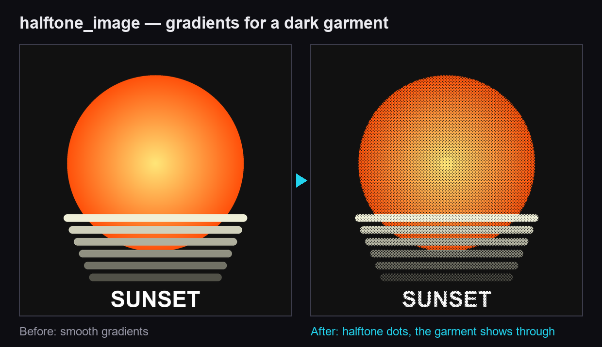

# PigmentaLab MCP — print-ready artwork from any AI agent

[](https://mcptry.com/servers/io.pigmentalab/mcp)
[](https://registry.modelcontextprotocol.io/v0/servers?search=io.pigmentalab/mcp)
[](LICENSE)

[PigmentaLab](https://pigmentalab.io) is a pre-press engine for **DTF (direct-to-film) and textile printing**. Its
remote MCP server lets Claude, ChatGPT, Cursor, VS Code, Gemini CLI and any MCP client check, clean, upscale,
halftone and gang-sheet images, for people who speak any language.





*Real outputs of the engine on the [sample images](#try-it): `remove_background` (1 credit) and
`halftone_image` with `style=garment` (0.5 credit).*

| | |
|---|---|
| Server URL (Streamable HTTP) | `https://mcp.pigmentalab.io/mcp` |
| Authentication | OAuth 2.1 (sign in at pigmentalab.io and press **Allow**) or an `X-API-Key` header |
| MCP Registry | [`io.pigmentalab/mcp`](https://registry.modelcontextprotocol.io/v0/servers?search=io.pigmentalab/mcp) |
| Guide | [pigmentalab.io/mcp](https://pigmentalab.io/mcp) · [llms.txt](https://pigmentalab.io/llms.txt) · [auth.md](https://pigmentalab.io/auth.md) |
| REST API | `https://api.pigmentalab.io/v1` · [OpenAPI 3.1](https://pigmentalab.io/mcp/openapi.json) · [examples](examples/) |

The server is hosted by PigmentaLab. This repository holds its public documentation, a Claude Code plugin, an agent
skill, REST examples and the registry manifest ([`server.json`](server.json)).

## Connect

With OAuth there is no key to copy: you sign in and allow. **Never paste a key into a chat.**

[](https://cursor.com/en/install-mcp?name=pigmentalab&config=eyJ1cmwiOiJodHRwczovL21jcC5waWdtZW50YWxhYi5pby9tY3AifQ%3D%3D)
[](https://vscode.dev/redirect/mcp/install?name=pigmentalab&config=%7B%22type%22%3A%22http%22%2C%22url%22%3A%22https%3A%2F%2Fmcp.pigmentalab.io%2Fmcp%22%7D)

**Claude Code: the plugin.** It connects the server and adds the DTF print-prep skill in one step:

```bash
claude plugin marketplace add bykarlos/pigmentalab-mcp
claude plugin install pigmentalab@pigmentalab
```

The first time a tool runs, Claude Code asks you to sign in to PigmentaLab. Only the server, without the skill:

```bash
claude mcp add --transport http pigmentalab https://mcp.pigmentalab.io/mcp
```

**Claude** (web, desktop and mobile): Settings → Connectors → *Add custom connector* → paste
`https://mcp.pigmentalab.io/mcp` → *Connect* → sign in to PigmentaLab → *Allow*.

**ChatGPT** (web, Business or Enterprise): *Plugins* → *+* → *Add custom MCP server* → `https://mcp.pigmentalab.io/mcp`
→ *OAuth* → *Create as a plugin* → sign in → *Allow*. Then type `@` in a new chat and pick PigmentaLab. Images you
attach in ChatGPT go straight to the tools.

**Cursor** (`~/.cursor/mcp.json`)

```json
{
  "mcpServers": {
    "pigmentalab": { "url": "https://mcp.pigmentalab.io/mcp" }
  }
}
```

**VS Code** (`.vscode/mcp.json`)

```json
{
  "servers": {
    "pigmentalab": { "type": "http", "url": "https://mcp.pigmentalab.io/mcp" }
  }
}
```

**Gemini CLI: the extension.** It connects the server and adds the print-prep instructions:

```bash
gemini extensions install https://github.com/bykarlos/pigmentalab-mcp
```

Then sign in with `/mcp auth pigmentalab`. Only the server, in `~/.gemini/settings.json`:

```json
{
  "mcpServers": {
    "pigmentalab": { "httpUrl": "https://mcp.pigmentalab.io/mcp" }
  }
}
```

**Any other MCP client:** Streamable HTTP at `https://mcp.pigmentalab.io/mcp`. Clients with MCP OAuth sign in by
themselves (OAuth 2.1 with PKCE, dynamic client registration and client ID metadata documents). Otherwise send
`X-API-Key: plb_live_...` (or `Authorization: Bearer plb_live_...`). Keys are created at
[pigmentalab.io/app/api](https://pigmentalab.io/app/api); a client that cannot send headers can use the personal link
from [mcp.pigmentalab.io/conectar](https://mcp.pigmentalab.io/conectar).

## Tools

1 credit = USD 0.01. Images over 25 megapixels cost double. Charged only when the result is delivered.

| Tool | What it does | Price |
|---|---|---|
| `inspect_image_for_print` | Can this image print at N cm? Real pixels, largest size at 300 and 150 dpi, transparency, ink and a verdict. | Free |
| `remove_background` | Transparent PNG, ready for a garment. | 1 credit |
| `upscale_image` | Enlarge to a print height in cm at 300 dpi, with clean edges (an engine made for logos and lettering). | 1 credit |
| `knockout_color` | Make black, white or one chosen color transparent so the garment shows through. | 0.5 credit |
| `halftone_image` | Artistic or garment-aware halftone dots. | 0.5 credit |
| `improve_image` | Colors, denoise, logo cleanup or face restoration. | 0.5–1 credit |
| `create_gangsheet` | Nest many designs on a roll, by their real silhouette, with as little waste as possible. | 5 credits + 3 per metre |
| `pigmenta_create_upload` | A short-lived upload page, in the person's language, for files the agent cannot forward. | Free |
| `pigmenta_guide` · `print_size_for_garment` · `print_advice` | What the PigmentaLab Bot knows: which tool for which job, print sizes by garment and size, advice by technique (DTF, UV DTF, sublimation, screen printing, vinyl, embroidery). | Free |
| `pigmenta_job_status` · `pigmenta_account` · `pigmenta_pricing` | Job results, balance and the live price list. | Free |

Background removal, halftones, knockout and gang sheets keep the artwork exactly as it is. Results are PNG files at
print resolution, with a download link that lasts four hours. Live prices:
[api.pigmentalab.io/v1/pricing](https://api.pigmentalab.io/v1/pricing).

### What an answer looks like

`inspect_image_for_print` on a 480 × 480 px design, asked for 30 cm (trimmed, real output):

```json
{
  "width_px": 480,
  "height_px": 480,
  "max_print_height_cm": { "at_300dpi_optimal": 4.1, "at_150dpi_minimum": 8.1 },
  "alpha": { "has_alpha": true, "soft_edge_ratio": 0.0 },
  "verdict_code": "does_not_fit",
  "verdict": "Does not fit: at 30 cm high it gets 40.6 DPI, below the 150 DPI floor. Without upscaling, the reasonable maximum is 8.1 cm high.",
  "credits_charged": 0
}
```

The agent explains it in the person's language, and offers `upscale_image` to reach 30 cm.

## Try it

Ask in your own words, in any language:

- *Can this logo print at 30 cm tall on a black t-shirt? If not, upscale it.*
- *Remove the background and lay out 10 copies of 8 cm on a 58 cm gang sheet.*
- *Sacale el fondo y armame una lámina de 58 cm con 10 copias de 8 cm.*
- *把这张图的背景去掉，然后放大到 30 厘米高。*
- *Faz um meio-tom desse desenho para camiseta preta.*

Sample images: [design-small.png](https://pigmentalab.io/mcp/ejemplos/design-small.png) ·
[logo-white-background.png](https://pigmentalab.io/mcp/ejemplos/logo-white-background.png) ·
[gradient-design.png](https://pigmentalab.io/mcp/ejemplos/gradient-design.png)

The REST API needs no key to read the price list:

```bash
curl https://api.pigmentalab.io/v1/pricing
```

More in [`examples/`](examples/): curl, Python and Node.

## Good to know

- **No key in the chat.** With OAuth the connection shows up as "Agente · …" among your keys at
  [pigmentalab.io/app/api](https://pigmentalab.io/app/api), where you can revoke it.
- **Files expire.** Upload links last 30 minutes and download links 4 hours. Full-resolution files never travel inside
  the chat.
- **Long jobs don't time out.** Heavy tools return a `job_id`; the agent polls `pigmenta_job_status` and is not charged
  twice.
- **Credit is managed on the website**, never inside a chat.

## What's in this repository

| Path | What it is |
|---|---|
| [`plugins/pigmentalab/`](plugins/pigmentalab/) | The Claude Code plugin: the MCP server and the [DTF print-prep skill](plugins/pigmentalab/skills/dtf-print-prep/SKILL.md) |
| [`.claude-plugin/marketplace.json`](.claude-plugin/marketplace.json) | The marketplace that `claude plugin marketplace add` reads |
| [`gemini-extension.json`](gemini-extension.json) · [`GEMINI.md`](GEMINI.md) | The Gemini CLI extension: the server and its instructions |
| [`examples/`](examples/) | The REST API from curl, Python and Node |
| [`AGENTS.md`](AGENTS.md) · [`llms.txt`](llms.txt) | For agents that read this repository |
| [`server.json`](server.json) | The manifest published to the official MCP Registry |
| [`glama.json`](glama.json) | Maintainer metadata for Glama |

## Support

[contacto@pigmentalab.io](mailto:contacto@pigmentalab.io), in any language · [pigmentalab.io/mcp](https://pigmentalab.io/mcp#support)
· [Privacy](https://pigmentalab.io/en/privacy) · [Terms](https://pigmentalab.io/en/terms)

## License

The documentation, examples, plugin and skill in this repository are under the [MIT License](LICENSE). The PigmentaLab
service and its server are not open source.
